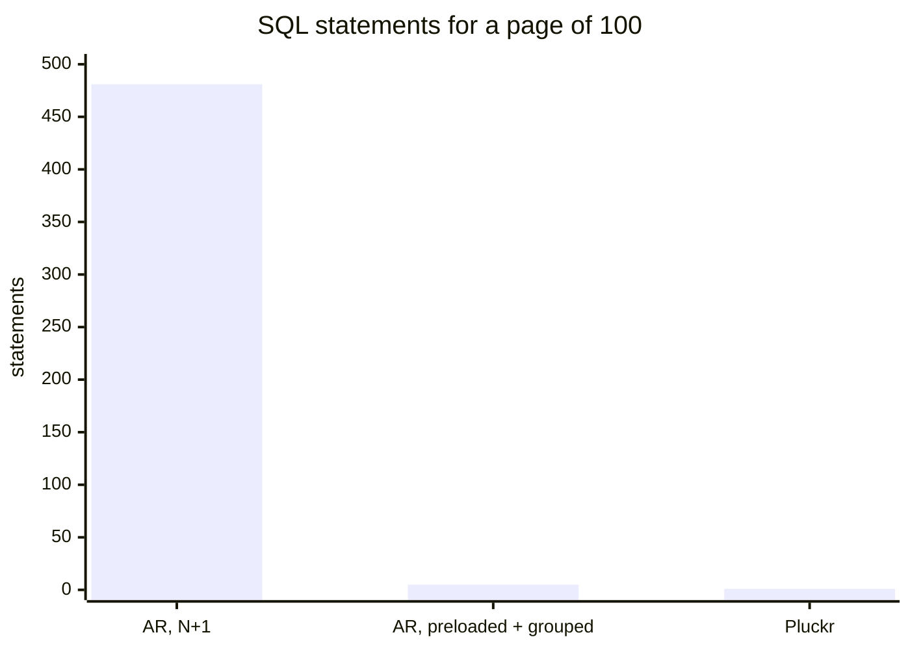

# Benchmarks

## TL;DR

Two read models, fetched three ways each. PostgreSQL 17, 50k users, indexed
schema.

**Every number here is a local laptop over a unix socket**, where a round trip
costs ~0.05-0.2 ms - so the absolute milliseconds are a floor, not a promise.
Production has a database on the other end of a network, and the one term Pluckr
removes is exactly the one that grows there:
[What to expect in production](#what-to-expect-in-production) estimates that
case - a page of 100 at a 1 ms round trip is ~529 ms of N+1, ~8 ms of careful
ActiveRecord and ~2 ms of Pluckr. Ratios travel; absolute times do not.

**`UserSummary`** - `id`, `email`, a nested `subscription.plan`, an existence
check and a count:

| rows | ActiveRecord, N+1 | ActiveRecord, preloaded + grouped | Pluckr |
| ---: | ---: | ---: | ---: |
| 1 | 5 SQL / 0.45 ms | - | **1 SQL / 0.24 ms** |
| 10 | 49 SQL / 4.99 ms | 5 SQL / 0.82 ms | **1 SQL / 0.35 ms** |
| 100 | 481 SQL / 48.0 ms | 5 SQL / 2.82 ms | **1 SQL / 0.96 ms** |
| 1,000 | 4,801 SQL / 490 ms | 5 SQL / 23.2 ms | **1 SQL / 11.7 ms** |
| 10,000 | 48,001 SQL / 4,983 ms | 5 SQL / 285 ms | **1 SQL / 95.5 ms** |

**`UserCard`** - the wide version: 3 fields with aliases, a nested
`subscription.plan`, a self-referential `manager`, an existence check, three
counts (one of them scoped) and a sum:

| rows | ActiveRecord, N+1 | ActiveRecord, preloaded + grouped | Pluckr |
| ---: | ---: | ---: | ---: |
| 10 | 89 SQL / 9.66 ms | 10 SQL / 1.92 ms | **1 SQL / 0.97 ms** |
| 100 | 881 SQL / 98.3 ms | 10 SQL / 6.04 ms | **1 SQL / 2.38 ms** |
| 1,000 | 8,801 SQL / 1,024 ms | 10 SQL / 69.9 ms | **1 SQL / 24.6 ms** |
| 10,000 | 88,001 SQL / 10,346 ms | 10 SQL / 590 ms | **1 SQL / 236 ms** |

**`UserCard.for(page)`** - the same card for an ordered page of users the caller
already has as a relation. `.for` reads the page's primary keys first, then the
card, so nothing is instantiated and the page and its order stay the relation's:

| rows | ActiveRecord, preloaded + grouped | Pluckr, `.for(page.to_a)` | Pluckr, `.for(ordered page)` |
| ---: | ---: | ---: | ---: |
| 10 | 10 SQL / 3.07 ms | 2 SQL / 2.18 ms | **2 SQL / 2.59 ms** |
| 100 | 10 SQL / 11.5 ms | 2 SQL / 10.9 ms | **2 SQL / 10.4 ms** |
| 1,000 | 10 SQL / 70.3 ms | 2 SQL / 36.4 ms | **2 SQL / 25.6 ms** |
| 10,000 | 10 SQL / 609 ms | 2 SQL / 321 ms | **2 SQL / 248 ms** |

- **2-3x faster than careful hand-written ActiveRecord**, which needs 5
  statements (10 for the wide card) and ~25-40 lines to avoid the N+1.
  **10-52x faster** than the N+1.
- **The wider the read model, the more it saves.** Every node the wide card adds
  costs ActiveRecord another statement; Pluckr still sends one.
- **1 statement, always.** Over a networked database that is worth another
  `(statements - 1) x round_trip` per request: ~6 ms saved per 100-row page at a
  1 ms round trip, ~500 ms against an N+1.
- **`.for` in bulk, never per record.** The same 100 records read one call at a
  time cost 100 statements and 85 ms; `.for(records)` costs 1 statement and
  4.3 ms - 20x, and 72x at 10,000 records.
- **An ordered page costs one extra statement, not a load.** `.for(relation)`
  with a `limit`/`offset` reads the page's keys, then the card: 2 statements, no
  ActiveRecord objects, still 1.1-2.7x ahead of the preloaded hand-written
  version, and ahead of loading the page yourself (`.for(page.to_a)`) once the
  page is big enough for instantiation to matter.
- **Same story on SQLite** (2.5-2.7x on lists) where round trips are free, so the
  win is not only latency - it is also the ActiveRecord object machinery Pluckr
  skips.
- **Correlated nodes cost per returned row, not per stored row**: a page of 100
  costs the same at 5k users as at 50k. Server-side time for a page of 10 is
  0.039 ms.
- **Index your foreign keys.** Without an index on `videos.user_id` the same page
  of 100 goes from 1.44 ms to 177 ms.
- Where it does not help: unbounded fetches of whole tables, dashboards whose
  cost is `COUNT(*)` scans, and anything whose real problem is a missing index.

Everything below is reproducible with `bundle exec ruby benchmarks/read_models.rb`.

## One picture

Statements are the term that survives the trip to production, because each one
costs a round trip no matter how fast the query is. A page of 100 rows of
`UserSummary`:



The milliseconds stay in the tables below: they span 0.24 ms to 10.4 s, and a
linear bar chart of that range shows one bar and three slivers.

## Where the numbers come from

Everything here comes from [`benchmarks/read_models.rb`](benchmarks/read_models.rb),
which seeds a database, runs the same read model three ways at four page sizes,
compares bulk `.for` against one call per record and an ordered page against
loading it, checks that the variants return identical data, and prints
`EXPLAIN ANALYZE` for the SQL Pluckr generates.

```bash
bundle exec ruby benchmarks/read_models.rb            # PostgreSQL, 50k users
DB=sqlite bundle exec ruby benchmarks/read_models.rb  # SQLite, in memory
PAGES=25,250 USERS=200000 RUNS=50 bundle exec ruby benchmarks/read_models.rb
KEEP=1 EXPLAIN=0 bundle exec ruby benchmarks/read_models.rb   # leave the data, skip plans
```

## Setup

| | |
| --- | --- |
| Hardware | Apple M3 laptop, local PostgreSQL 17 over a unix socket; SQLite in memory |
| Software | Ruby 3.4.5, ActiveRecord 8.1.3.1 |
| Dataset | 50k users (25k active), 35k subscriptions, 5 plans, 60k photos, 75k videos, 50k comments, 2k accounts |
| Read models | `UserSummary` (6 outputs, 1 join, 2 correlated nodes) and `UserCard` (12 outputs, 3 joins, 6 correlated nodes incl. a scoped count and a sum) |

The schema is indexed the way a production schema should be, which is what makes
the numbers meaningful:

```ruby
add_index :users, :email, unique: true
add_index :users, %i[active id]           # the paged list query
add_index :users, :created_at
add_index :users, :manager_id
add_index :users, :region_code
add_index :subscriptions, :user_id, unique: true   # has_one
add_index :subscriptions, :plan_id
add_index :profiles, :owner_id, unique: true       # has_one, custom key
add_index :photos, :user_id
add_index :videos, :user_id
add_index :videos, %i[user_id size]                # filtered counts
add_index :comments, :user_id
add_index :documents, %i[user_id type]             # STI
add_index :likes, %i[likeable_type likeable_id]    # polymorphic
add_index :accounts, :active
add_index :orders, %i[status amount]
add_index :orders, %i[user_id status]              # per-user order aggregates
```

`median ms` is the median of timed runs measured in Ruby around the whole call,
so it includes connection time, SQL execution and object construction.
`allocations` is `GC.stat(:total_allocated_objects)` for one call. The N+1
variant gets fewer samples on the big pages because it issues 4 statements per
row. Absolute numbers on a laptop move ±30% between runs; the ratios are the
point.

## PostgreSQL

```
adapter: PostgreSQL  users: 50000  pages: 10, 100, 1000, 10000  runs: 25
```

| | rows | SQL | median ms | allocations | vs Pluckr |
| --- | ---: | ---: | ---: | ---: | ---: |
| **Single record** | | | | | |
| ActiveRecord, record + questions | 1 | 5 | 0.452 | 680 | 1.9x |
| Pluckr | 1 | 1 | 0.241 | 435 | 1.0x |
| **List** | | | | | |
| ActiveRecord, N+1 | 10 | 49 | 4.985 | 6,555 | 14.4x |
| ActiveRecord, preloaded + grouped | 10 | 5 | 0.820 | 1,325 | 2.4x |
| Pluckr | 10 | 1 | 0.345 | 908 | 1.0x |
| ActiveRecord, N+1 | 100 | 481 | 48.033 | 64,246 | 49.9x |
| ActiveRecord, preloaded + grouped | 100 | 5 | 2.818 | 4,982 | 2.9x |
| Pluckr | 100 | 1 | 0.963 | 5,751 | 1.0x |
| ActiveRecord, N+1 | 1,000 | 4,801 | 490.351 | 641,146 | 42.0x |
| ActiveRecord, preloaded + grouped | 1,000 | 5 | 23.202 | 41,528 | 2.0x |
| Pluckr | 1,000 | 1 | 11.687 | 54,171 | 1.0x |
| ActiveRecord, N+1 | 10,000 | 48,001 | 4983.391 | 6,410,146 | 52.2x |
| ActiveRecord, preloaded + grouped | 10,000 | 5 | 285.338 | 406,928 | 3.0x |
| Pluckr | 10,000 | 1 | 95.528 | 538,371 | 1.0x |
| **Records already in memory (`.for`)** | | | | | |
| Pluckr, .for per record | 10 | 10 | 6.873 | 4,155 | 6.5x |
| Pluckr, .for in bulk | 10 | 1 | 1.061 | 919 | 1.0x |
| Pluckr, .for per record | 100 | 100 | 84.806 | 41,397 | 19.5x |
| Pluckr, .for in bulk | 100 | 1 | 4.340 | 5,942 | 1.0x |
| Pluckr, .for per record | 1,000 | 1,000 | 850.136 | 413,870 | 34.3x |
| Pluckr, .for in bulk | 1,000 | 1 | 24.771 | 56,162 | 1.0x |
| Pluckr, .for per record | 10,000 | 10,000 | 8269.090 | 4,138,017 | 72.1x |
| Pluckr, .for in bulk | 10,000 | 1 | 114.713 | 558,362 | 1.0x |
| **Wide card (`UserCard`)** | | | | | |
| ActiveRecord, N+1 | 10 | 89 | 9.662 | 13,655 | 10.0x |
| ActiveRecord, preloaded + grouped | 10 | 10 | 1.917 | 2,918 | 2.0x |
| Pluckr | 10 | 1 | 0.967 | 1,807 | 1.0x |
| ActiveRecord, N+1 | 100 | 881 | 98.338 | 135,246 | 41.3x |
| ActiveRecord, preloaded + grouped | 100 | 10 | 6.036 | 12,609 | 2.5x |
| Pluckr | 100 | 1 | 2.382 | 10,250 | 1.0x |
| ActiveRecord, N+1 | 1,000 | 8,801 | 1023.776 | 1,351,146 | 41.7x |
| ActiveRecord, preloaded + grouped | 1,000 | 10 | 69.938 | 109,465 | 2.8x |
| Pluckr | 1,000 | 1 | 24.565 | 94,670 | 1.0x |
| ActiveRecord, N+1 | 10,000 | 88,001 | 10346.386 | 13,510,199 | 43.8x |
| ActiveRecord, preloaded + grouped | 10,000 | 10 | 590.034 | 1,077,865 | 2.5x |
| Pluckr | 10,000 | 1 | 236.061 | 938,870 | 1.0x |
| **Ordered page via `.for` (`UserCard`)** | | | | | |
| ActiveRecord, preloaded + grouped | 10 | 10 | 3.073 | 2,918 | 1.2x |
| Pluckr, .for(page.to_a) | 10 | 2 | 2.178 | 2,046 | 0.8x |
| Pluckr, .for(ordered page) | 10 | 2 | 2.593 | 1,950 | 1.0x |
| ActiveRecord, preloaded + grouped | 100 | 10 | 11.515 | 12,609 | 1.1x |
| Pluckr, .for(page.to_a) | 100 | 2 | 10.918 | 11,570 | 1.1x |
| Pluckr, .for(ordered page) | 100 | 2 | 10.366 | 10,664 | 1.0x |
| ActiveRecord, preloaded + grouped | 1,000 | 10 | 70.276 | 109,465 | 2.7x |
| Pluckr, .for(page.to_a) | 1,000 | 2 | 36.369 | 106,790 | 1.4x |
| Pluckr, .for(ordered page) | 1,000 | 2 | 25.607 | 97,784 | 1.0x |
| ActiveRecord, preloaded + grouped | 10,000 | 10 | 608.651 | 1,077,865 | 2.5x |
| Pluckr, .for(page.to_a) | 10,000 | 2 | 321.059 | 1,058,990 | 1.3x |
| Pluckr, .for(ordered page) | 10,000 | 2 | 248.405 | 968,984 | 1.0x |
| **Dashboard, 3 counts** | | | | | |
| ActiveRecord, three counts | 1 | 3 | 2.515 | 262 | 1.3x |
| Pluckr | 1 | 1 | 2.007 | 294 | 1.0x |

## SQLite

```
adapter: SQLite  users: 50000  pages: 10, 100, 1000, 10000  runs: 25
```

| | rows | SQL | median ms | allocations | vs Pluckr |
| --- | ---: | ---: | ---: | ---: | ---: |
| **Single record** | | | | | |
| ActiveRecord, record + questions | 1 | 5 | 0.368 | 667 | 2.1x |
| Pluckr | 1 | 1 | 0.177 | 440 | 1.0x |
| **List** | | | | | |
| ActiveRecord, N+1 | 10 | 49 | 3.627 | 6,422 | 15.8x |
| ActiveRecord, preloaded + grouped | 10 | 5 | 0.605 | 1,305 | 2.6x |
| Pluckr | 10 | 1 | 0.229 | 904 | 1.0x |
| ActiveRecord, N+1 | 100 | 481 | 38.097 | 63,033 | 46.4x |
| ActiveRecord, preloaded + grouped | 100 | 5 | 2.212 | 4,329 | 2.7x |
| Pluckr | 100 | 1 | 0.821 | 5,656 | 1.0x |
| ActiveRecord, N+1 | 1,000 | 4,801 | 389.682 | 629,139 | 54.8x |
| ActiveRecord, preloaded + grouped | 1,000 | 5 | 17.705 | 37,608 | 2.5x |
| Pluckr | 1,000 | 1 | 7.109 | 53,176 | 1.0x |
| ActiveRecord, N+1 | 10,000 | 48,001 | 3680.194 | 6,290,152 | 50.4x |
| ActiveRecord, preloaded + grouped | 10,000 | 5 | 186.846 | 367,008 | 2.6x |
| Pluckr | 10,000 | 1 | 73.092 | 528,376 | 1.0x |
| **Records already in memory (`.for`)** | | | | | |
| Pluckr, .for per record | 10 | 10 | 1.899 | 4,205 | 7.9x |
| Pluckr, .for in bulk | 10 | 1 | 0.239 | 915 | 1.0x |
| Pluckr, .for per record | 100 | 100 | 19.017 | 41,897 | 21.5x |
| Pluckr, .for in bulk | 100 | 1 | 0.886 | 5,847 | 1.0x |
| Pluckr, .for per record | 1,000 | 1,000 | 190.153 | 418,817 | 23.4x |
| Pluckr, .for in bulk | 1,000 | 1 | 8.141 | 55,167 | 1.0x |
| Pluckr, .for per record | 10,000 | 10,000 | 1881.776 | 4,188,017 | 21.6x |
| Pluckr, .for in bulk | 10,000 | 1 | 87.050 | 548,367 | 1.0x |
| **Wide card (`UserCard`)** | | | | | |
| ActiveRecord, N+1 | 10 | 89 | 7.813 | 13,662 | 13.9x |
| ActiveRecord, preloaded + grouped | 10 | 10 | 1.277 | 2,882 | 2.3x |
| Pluckr | 10 | 1 | 0.563 | 1,800 | 1.0x |
| ActiveRecord, N+1 | 100 | 881 | 79.187 | 135,432 | 42.8x |
| ActiveRecord, preloaded + grouped | 100 | 10 | 5.273 | 11,036 | 2.9x |
| Pluckr | 100 | 1 | 1.850 | 10,152 | 1.0x |
| ActiveRecord, N+1 | 1,000 | 8,801 | 819.324 | 1,353,190 | 52.8x |
| ActiveRecord, preloaded + grouped | 1,000 | 10 | 39.273 | 100,701 | 2.5x |
| Pluckr | 1,000 | 1 | 15.507 | 93,672 | 1.0x |
| ActiveRecord, N+1 | 10,000 | 88,001 | 8205.587 | 13,530,197 | 46.6x |
| ActiveRecord, preloaded + grouped | 10,000 | 10 | 410.917 | 988,101 | 2.3x |
| Pluckr | 10,000 | 1 | 176.146 | 928,872 | 1.0x |
| **Ordered page via `.for` (`UserCard`)** | | | | | |
| ActiveRecord, preloaded + grouped | 10 | 10 | 1.289 | 2,882 | 2.0x |
| Pluckr, .for(page.to_a) | 10 | 2 | 0.654 | 2,026 | 1.0x |
| Pluckr, .for(ordered page) | 10 | 2 | 0.632 | 1,942 | 1.0x |
| ActiveRecord, preloaded + grouped | 100 | 10 | 4.498 | 11,036 | 2.3x |
| Pluckr, .for(page.to_a) | 100 | 2 | 2.176 | 11,458 | 1.1x |
| Pluckr, .for(ordered page) | 100 | 2 | 1.975 | 10,564 | 1.0x |
| ActiveRecord, preloaded + grouped | 1,000 | 10 | 40.661 | 100,701 | 2.5x |
| Pluckr, .for(page.to_a) | 1,000 | 2 | 18.941 | 105,778 | 1.2x |
| Pluckr, .for(ordered page) | 1,000 | 2 | 16.221 | 96,784 | 1.0x |
| ActiveRecord, preloaded + grouped | 10,000 | 10 | 406.706 | 988,101 | 2.3x |
| Pluckr, .for(page.to_a) | 10,000 | 2 | 180.932 | 1,048,978 | 1.0x |
| Pluckr, .for(ordered page) | 10,000 | 2 | 173.860 | 958,984 | 1.0x |
| **Dashboard, 3 counts** | | | | | |
| ActiveRecord, three counts | 1 | 3 | 0.136 | 271 | 1.0x |
| Pluckr | 1 | 1 | 0.141 | 292 | 1.0x |

SQLite is in the same process, so its round trips are nearly free - and Pluckr
still wins by 2.5-2.8x on lists, because the work it avoids is instantiating
ActiveRecord objects and running four queries' worth of AR machinery, not just
network latency. On a networked database the gap widens (see below).

The "preloaded + grouped" row is the honest comparison: `includes(subscription:
:plan)` plus a `distinct.pluck` for existence plus a `group(:user_id).count`,
then merged in Ruby. It is what a careful developer writes, and it is 5
statements and ~25 lines. Pluckr is one statement and one class.

The wide card shows where that approach stops scaling: every extra aggregate is
another grouped query and another merge loop, so the hand-written version grows
to 10 statements and ~40 lines while Pluckr stays at one statement and one class
- and gets *relatively* faster as the model widens.

Two things do **not** improve: allocations on lists (Pluckr builds its own result
objects, so it lands near preloaded ActiveRecord - the 10x saving is against the
N+1 version), and the dashboard, which is dominated by `COUNT(*)` scans that no
query shape avoids.

## What the plans look like

### Single record — 0.026 ms in the database

```
Limit (actual time=0.024..0.024 rows=1 loops=1)
  ->  Nested Loop Left Join
        ->  Index Scan using users_pkey on users
        ->  Index Scan using index_subscriptions_on_user_id on subscriptions pluckr_subscription
        SubPlan 1                                     -- exists :photos
          ->  Limit
                ->  Index Only Scan using index_photos_on_user_id on photos pluckr_sub_1
                      Index Cond: (user_id = users.id)
        SubPlan 2                                     -- count :videos
          ->  Aggregate
                ->  Index Only Scan using index_videos_on_user_id_and_size on videos pluckr_sub_2
                      Index Cond: (user_id = users.id)
Execution Time: 0.026 ms
```

### List of 10 — 0.039 ms in the database

```
Limit (actual time=0.019..0.038 rows=10 loops=1)
  ->  Nested Loop Left Join
        ->  Merge Left Join
              ->  Index Scan using users_pkey on users     Filter: active
              ->  Index Scan using index_subscriptions_on_user_id on subscriptions
        SubPlan 1
          ->  Limit (loops=10)                             -- 10 index probes, not a scan
                ->  Index Only Scan using index_photos_on_user_id on photos
                      Heap Fetches: 0
        SubPlan 2
          ->  Aggregate (loops=10)
                ->  Index Only Scan using index_videos_on_user_id_and_size on videos
                      Heap Fetches: 0
Execution Time: 0.039 ms
```

`loops=10` on both subplans is the whole design: each correlated node is one
index probe per returned row, never a join that multiplies rows and never a
`GROUP BY` over the whole table. `Heap Fetches: 0` means the covering indexes
answer both without touching the tables.

### Wide card, list of 10 — 0.104 ms in the database

Twelve outputs, three joined tables and six correlated subqueries, still one
statement and still index probes all the way down:

```
Limit (actual time=0.024..0.079 rows=10 loops=1)
  ->  Nested Loop Left Join
        ->  Nested Loop Left Join
              ->  Merge Left Join
                    ->  Index Scan using index_users_on_active_and_id on users
                    ->  Index Scan using index_subscriptions_on_user_id on subscriptions
              ->  Materialize -> Seq Scan on plans      (5 rows, cached)
        ->  Index Scan using users_pkey on users pluckr_manager   (loops=10)
              Index Cond: (id = users.manager_id)                 -- self-referential `one`
        SubPlan 1  Limit -> Index Only Scan on photos             (loops=10)  exists :photos
        SubPlan 2  Aggregate -> Index Only Scan on videos         (loops=10)  count :videos
        SubPlan 3  Aggregate -> Index Only Scan on videos         (loops=10)  scoped count
                     Index Cond: ((user_id = users.id) AND (size >= 200))
        SubPlan 4  Aggregate -> Index Only Scan on comments       (loops=10)  count :comments
        SubPlan 5  Aggregate -> Index Only Scan on orders         (loops=10)  count, where:
        SubPlan 6  Aggregate -> Index Only Scan on orders         (loops=10)  sum, where:
Execution Time: 0.104 ms
```

SubPlan 3 is the interesting one: `count :videos, scope: ->(rel) { rel.where(size:
200..) }` compiles to a derived table, PostgreSQL flattens it, and the scope's
condition ends up *inside* the index condition on `[user_id, size]`. The scoped
count costs the same as the unscoped one.

### Dashboard — 4.4 ms in the database

```
Result (actual time=4.422..4.422 rows=1 loops=1)
  InitPlan 1 -> Aggregate -> Index Only Scan on users      (50,000 rows, 2.268 ms)
  InitPlan 2 -> Aggregate -> Seq Scan on comments          (50,000 rows, 2.118 ms)
  InitPlan 3 -> Aggregate -> Seq Scan on accounts          (   666 rows, 0.036 ms)
```

Three independent aggregates, one round trip, each an `InitPlan` evaluated once.
The cost is the `COUNT(*)` scans themselves - exactly what three separate
ActiveRecord `.count` calls pay, minus two round trips.

## Why `exists` carries `LIMIT 1 OFFSET 0`

`exists :photos` compiles to:

```sql
EXISTS (SELECT 1 FROM photos WHERE photos.user_id = users.id LIMIT 1 OFFSET 0)
```

The tail is not decoration. Left alone, PostgreSQL turns a correlated `EXISTS` in
the SELECT list into a *hashed* subplan: it scans the entire child table once and
builds a hash. That is a good choice for an unbounded query and a terrible one
for a page of 50. `OFFSET 0` is the standard optimisation fence - it blocks the
rewrite, and the plan becomes an index probe per row that stops at the first
match. It parses on PostgreSQL, MySQL and SQLite, and is a no-op on the latter
two.

Same query, 50k users / 60k photos, page of 50, only the existence expression
changed:

| Expression | median ms | plan on `photos` |
| --- | ---: | --- |
| `EXISTS (SELECT 1 ...)` | 4.98 | Seq Scan, 60,000 rows |
| `EXISTS (... LIMIT 1)` | 4.11 | Seq Scan, 60,000 rows |
| `EXISTS (... ORDER BY 1)` | 4.64 | Seq Scan, 60,000 rows |
| `CASE WHEN EXISTS (...) THEN TRUE ELSE FALSE END` | 3.42 | Seq Scan, 60,000 rows |
| `COALESCE((SELECT TRUE ... LIMIT 1), FALSE)` | 0.15 | Index Only Scan |
| `EXISTS (... OFFSET 0)` | 0.07 | Index Only Scan |
| **`EXISTS (... LIMIT 1 OFFSET 0)`** | **0.07** | **Index Only Scan, stops at first row** |

Only the fence matters; `LIMIT 1` alone does nothing. The scalar `COALESCE` form
performs the same and was the first fix, but a real `EXISTS` reads better in
`to_sql` output and keeps the intent obvious, so that is what ships.

The trade-off is one-sided but real: on an unbounded fetch of all 25k active
users the hashed plan is competitive (~10 ms against ~15 ms), because one scan
beats 25k probes. Pluckr optimises for the paged case, which is what read models
are for.

## How it scales

From the tables above, PostgreSQL, per returned row:

| rows | median ms | µs per row |
| ---: | ---: | ---: |
| 1 | 0.253 | - |
| 10 | 0.347 | ~35 |
| 100 | 0.988 | ~10 |
| 1,000 | 11.672 | ~12 |
| 10,000 | 98.479 | ~10 |

Linear in rows returned past a ~0.2 ms floor, and flat in table size: a page of
100 costs the same at 5k users as at 50k. Correlated nodes cost per *returned*
row, not per stored row. Most of the per-row cost above 100 rows is Ruby building
result objects, not the database - the server-side time for a page of 10 is
0.039 ms.

That holds only while the foreign keys are indexed. Dropping both indexes on
`videos.user_id` and re-running a page of 100:

| | median ms |
| --- | ---: |
| indexed | 1.44 |
| no index on `videos.user_id` | 177.68 |

123x, because each of the 100 count probes becomes a sequential scan of 75k rows.
Rails indexes `t.references` by default; if a foreign key used by `exists` or
`count` is not indexed, fix that before anything else.

## What to expect in production

These numbers were measured over a unix socket, where a round trip costs
~0.05-0.2 ms. Production is not that. On a managed database the round trip is
usually 0.3-1 ms in the same availability zone and 2-5 ms across zones, and that
term is multiplied by the number of statements:

```
request time ≈ statements × round_trip + Σ execution + hydration
```

For a page of 100, at a 1 ms round trip:

| | statements | round trips | rest | ≈ total |
| --- | ---: | ---: | ---: | ---: |
| ActiveRecord, N+1 | 481 | 481 ms | ~48 ms | **~529 ms** |
| ActiveRecord, preloaded + grouped | 5 | 5 ms | ~2.8 ms | **~8 ms** |
| Pluckr | 1 | 1 ms | ~1.0 ms | **~2 ms** |

So the further the database is, the more one statement is worth. Against
*careful* ActiveRecord the saving is roughly `(statements - 1) × round_trip` per
request on top of the 2-3x measured here - a few milliseconds each, which shows
up at p99 and under connection pool pressure more than in a benchmark. Against a
forgotten preload it is two orders of magnitude.

Reasonable expectations for a real application:

- **Index and detail endpoints**: 1 statement instead of 4-10, and 2-3x lower
  latency even with the database on the same machine.
- **Wide tables**: Pluckr selects only declared columns, so a 60-column `users`
  table with a 5-field read model transfers and parses a fraction of the bytes.
  The benchmark model is narrow, so it understates this.
- **Object churn**: no ActiveRecord instances, no attribute hashes, no dirty
  tracking. Against an N+1 the allocation drop is ~10x, which shows up as GC time
  under load rather than in a single-request median.
- **Dashboards**: the saving is round trips, not scan time. `COUNT(*)` over a
  large table is slow in PostgreSQL no matter who writes the SQL; for tables in
  the tens of millions use rollup tables or approximate counts and read *those*
  with Pluckr.
- **Page sizes**: tens to low hundreds is the sweet spot. 10,000 rows in one
  query works (98 ms) but at that size you are paying for object construction,
  and something like `select_all` on a flat projection may serve you better.
- **Where it will not help**: unbounded fetches of entire tables, write paths,
  anything needing callbacks or validations, and queries whose real problem is a
  missing index rather than a round trip.

Verify on your own data before believing any of this: `UserSummary.to_sql` gives
you the statement, and `EXPLAIN ANALYZE` on it gives you the truth.
