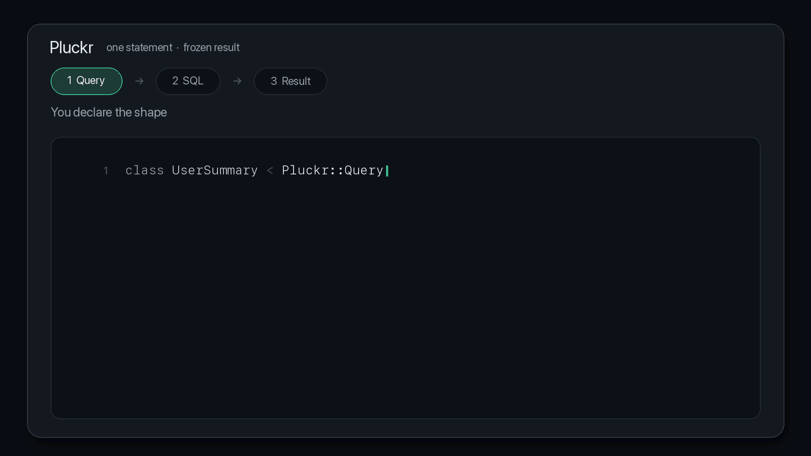

# Pluckr



<a href="https://igorkasyanchuk.com/apps?ref=pluckr">
  <picture>
    <source media="(prefers-color-scheme: dark)" srcset="https://igorkasyanchuk.com/versions/v1/banner-dark.svg">
    
  </picture>
</a>

A declarative read-query layer for ActiveRecord. Declare the shape, get one SQL
statement and a frozen, ActiveRecord-free object.

```ruby
user.id
user.email
user.subscription.name   # +1 query
user.photos.exists?      # +1 query
user.videos.count        # +1 query
```

becomes:

```ruby
class UserSummary < Pluckr::Query
  source User

  schema do
    field :id
    field :email

    one :subscription do
      field :id
      field :name
    end

    exists :photos
    count :videos
  end
end

user = UserSummary.find(1)

user.id             # => 1
user.email          # => "user@example.com"
user.subscription   # => #<UserSummary.subscription id=5, name="Pro"> (nil if none)
user.photos_exists  # => true
user.videos_count   # => 2
user.to_h           # => {id: 1, email: "...", subscription: {...}, photos_exists: true, videos_count: 2}
```

```sql
SELECT "users"."id"                    AS "id",
       "users"."email"                 AS "email",
       "pluckr_subscription"."id"      AS "__pluckr.subscription.present",
       "pluckr_subscription"."id"      AS "subscription.id",
       "pluckr_subscription"."name"    AS "subscription.name",
       EXISTS (SELECT 1 FROM "photos" "pluckr_sub_1"
                WHERE "pluckr_sub_1"."user_id" = "users"."id"
                LIMIT 1 OFFSET 0)      AS "photos_exists",
       (SELECT COUNT(*) FROM "videos" "pluckr_sub_2"
         WHERE "pluckr_sub_2"."user_id" = "users"."id") AS "videos_count"
  FROM "users"
  LEFT OUTER JOIN "subscriptions" "pluckr_subscription"
    ON "pluckr_subscription"."user_id" = "users"."id"
```

## Is it worth it?

PostgreSQL, 50k users, one page of this read model ([full results](BENCHMARKS.md)):

| rows | ActiveRecord, N+1 | ActiveRecord, preloaded + grouped | Pluckr |
| ---: | ---: | ---: | ---: |
| 10 | 49 SQL / 5.00 ms | 5 SQL / 0.85 ms | **1 SQL / 0.36 ms** |
| 100 | 481 SQL / 49.1 ms | 5 SQL / 2.89 ms | **1 SQL / 0.96 ms** |
| 1,000 | 4,801 SQL / 493 ms | 5 SQL / 23.6 ms | **1 SQL / 12.3 ms** |
| 10,000 | 48,001 SQL / 4,882 ms | 5 SQL / 290 ms | **1 SQL / 98.3 ms** |

2–3× faster than careful ActiveRecord, 10–51× faster than a forgotten preload.
One statement, always.

## Install

```ruby
gem "pluckr"
```

Ruby 3.2+, ActiveRecord 7.1+. PostgreSQL, MySQL, SQLite.

## Querying

```ruby
UserSummary.find(1)                       # raises ActiveRecord::RecordNotFound
UserSummary.fetch                         # array
UserSummary.where(active: true)
           .order(created_at: :desc)
           .limit(50)
           .offset(100)
           .fetch
UserSummary.where(active: true).to_sql

UserSummary.for(user)                     # one record you already have
UserSummary.for(users)                    # those records, one statement, same order
UserSummary.for(User.active)              # a relation, still one statement

UserSummary.find_by(email: "a@b.c")       # first match, or nil (find_by! raises)
UserSummary.last                          # first(n) / last(n) / take(n) too
UserSummary.where(active: true).count     # SELECT COUNT(*)
UserSummary.where(active: true).exists?   # SELECT 1
UserSummary.find_each { |row| ... }       # keyset pages, never OFFSET
UserSummary.where(active: true).explain
```

`where` / `where.not` / `order` / `limit` / `offset` pass through to the root
relation. Chains are immutable. A read is one statement.

Exceptions: paginated `.for` is two (keys, then the read model). A preloaded
page (`includes` / `eager_load`) is loaded the way ActiveRecord loads it.
`find_each` / `in_batches` are one per page. `count` / `exists?` / `any?` /
`none?` / `empty?` / `one?` / `many?` compile no nodes.

`.for` a collection or multi-id `find` needs `field :id`. A record you handed
over that is gone raises `RecordNotFound`; a relation just omits the row.
`group` / `having` raises — load it (`for(relation.to_a)`).

Do not loop `.for`. Lists you do not already have as AR objects stay
`UserSummary.where(...).fetch`.

`find_each` / `in_batches` need `field :id`, ignore your `order`, and refuse a
chain that already has `limit` / `offset`.

## Dashboards

No `source` — one object of independent aggregates:

```ruby
class DashboardStats < Pluckr::Query
  schema do
    count :users,    from: User
    count :comments, from: Comment
    count :active_accounts, from: Account, where: { active: true }

    sum :paid_revenue, from: Order, column: :amount, where: { status: "paid" }
    max :last_signup,  from: User,  column: :created_at
  end
end

stats = DashboardStats.fetch
stats.users            # => 1520
stats.active_accounts  # => 904
stats.to_h             # => {users: 1520, comments: 48203, ...}
```

```sql
SELECT (SELECT COUNT(*) FROM "users") AS "users",
       (SELECT COUNT(*) FROM "comments") AS "comments",
       (SELECT COUNT(*) FROM "accounts" WHERE "accounts"."active" = TRUE) AS "active_accounts"
```

## Ad-hoc aggregates

Runtime aggregates over relations you already have — one statement:

```ruby
stats = Pluckr.batch do |b|
  b.count  user.videos,                           as: :video_count
  b.sum    user.videos.where(size: 100..), :size, as: :big_video_bytes
  b.avg    user.videos, :size,                    as: :average_size
  b.exists user.photos,                           as: :has_photos
  b.count  Account.active,                        as: :active_accounts
end

stats.video_count      # => 3
stats.has_photos       # => true
```

Each entry wraps the relation's own SQL, so `default_scope`, `:through`, STI,
`joins`, `merge`, `distinct`, `group`, `limit` all apply. `as:` is required.
`count` / `sum` / `avg` (`average`) / `min` / `max` / `exists`. A model class
works (`b.count User, as: :users`). `Pluckr::Batch.build { ... }` is the
unexecuted form (`#to_sql`, `#fetch`).

A batch answers one subject. For a column on every row of an index page, define
a query.

## DSL

| Node | Result | SQL |
| --- | --- | --- |
| `field :email` | `email` | selected column |
| `field :email, as: :contact` | `contact` | selected column |
| `one :subscription do ... end` | `subscription` (or `nil`) | `LEFT OUTER JOIN` |
| `one :plan, via: :subscription do ... end` | `plan` | `LEFT OUTER JOIN` |
| `first :comment, via: :comments do ... end` | `comment` (or `nil`) | correlated `LIMIT 1` |
| `last :comment, via: :comments, order: :created_at do ... end` | `comment` | correlated `LIMIT 1` |
| `exists :photos` | `photos_exists` | correlated `EXISTS` |
| `exists :photos, as: :has_photos` | `has_photos` | correlated `EXISTS` |
| `count :videos` | `videos_count` | scalar subquery |
| `count :videos, as: :n_videos` | `n_videos` | scalar subquery |
| `count :users, from: User` | `users` | scalar subquery |
| `sum/avg/min/max ..., column: :amount` | `<name>_sum`, `<name>_avg`, ... | scalar subquery |

`exists` / `count` / `sum` / `avg` / `min` / `max` take `where:` and `scope:`
(`average` aliases `avg`, output is still `<name>_avg`):

```ruby
count :active_accounts, from: Account, where: { active: true }
count :active_accounts, from: Account, scope: ->(rel) { rel.active }

count  :big_videos, via: :videos, scope: ->(rel) { rel.where(size: 100..) }
exists :recent_photos, via: :photos, scope: -> { Photo.where(created_at: 1.week.ago..) }
```

`where:` is a Hash **or** a zero-argument callable returning one. A Hash is
frozen at class load:

```ruby
count :recent_orders, from: Order, where: { created_at: 1.week.ago.. }      # week before boot, forever
count :recent_orders, from: Order, where: -> { { created_at: 1.week.ago.. } }  # what you meant
```

`scope:` receives the relation (or nothing) and must return one for the same
model. `limit` / `offset` / `group` inside a scope raise.

`one` nests:

```ruby
one :subscription do
  field :name
  one :plan do
    field :name
  end
end

user.subscription.plan.name
```

Joins come from ActiveRecord reflection. `has_many` is never joined — use
`exists` / `count` / `first` / `last`. Leave the `OFFSET 0` on `EXISTS` alone
([why](BENCHMARKS.md#why-exists-carries-limit-1-offset-0)).

### One row out of many

```ruby
class UserSummary < Pluckr::Query
  source User

  schema do
    field :email

    last :comment, via: :comments do          # newest by primary key
      field :body
      field :created_at
    end

    last :signup_order, via: :orders, order: :created_at do
      field :amount
    end
  end
end

user.comment.body        # => "the latest one"   (nil if none)
user.signup_order.amount
```

`last` matches `relation.order(...).last`. No `order:` → primary key. Blocks
are fields only in v0.1; no `where:` / `scope:` yet. Index `[foreign_key, order_column]`.

### `has_one` needs a unique index

`one` is a `LEFT OUTER JOIN`. Duplicate child rows duplicate the parent — unique
the FK:

```ruby
add_index :subscriptions, :user_id, unique: true
add_index :profiles, :owner_id, unique: true       # has_one :profile, foreign_key: :owner_id
```

### Missing vs NULL

```ruby
user.subscription        # => nil     no row
user.subscription.name   # => nil     row exists, name is NULL
```

## Result objects

Frozen, ActiveRecord-free, one reader per declared output:

```ruby
user.class.ancestors.include?(ActiveRecord::Base) # => false
user.frozen?                                      # => true
user[:email]
user.to_h          # nested, internal aliases stripped
user.created_at    # NoMethodError - not selected
```

Cast with the model's column types. `count` / `sum` over no rows are `0`;
`min` / `max` / `avg` are `nil`. `avg` is a `BigDecimal`.

```ruby
result.to_json   # => {"id":1,"email":"...","subscription":{"name":"Pro"},"videos_count":2}
result.as_json   # => {"id" => 1, ...}
result.to_hash   # => {id: 1, ...}, so **result works too
```

## Errors, early

Schema mistakes raise at class-definition time:

```ruby
field :does_not_exist  # Pluckr::UnknownField: User does not have column `does_not_exist`
one :unknown           # Pluckr::UnknownAssociation: User does not have association `unknown`
one :photos            # Pluckr::InvalidAssociation: `User#photos` is a has_many association
                       #   and cannot be used with `one`
field :id              # Pluckr::MissingSource (no `source` declared)
schema { }             # Pluckr::ConfigurationError: `schema` block is empty
count :x, scope: {}    # Pluckr::ConfigurationError: `scope:` expects a callable
```

Compile-time checks (`scope:` return value, alias length, one connection) raise
on first `to_sql` / `fetch`.

## Instrumentation

```ruby
ActiveSupport::Notifications.subscribe("fetch.pluckr") do |*args|
  event = ActiveSupport::Notifications::Event.new(*args)

  event.payload[:name]  # => "UserSummary" (or "Pluckr::Batch")
  event.payload[:sql]   # => "SELECT ..."
  event.payload[:rows]  # => 100
  event.duration        # => 0.96 (ms)
end
```

Covers every statement Pluckr compiles. `count` / `exists?` and the key `pluck`
for a paginated `.for` are ActiveRecord's (`sql.active_record`).

## How it works

```
DSL -> schema AST -> reflection -> SQL compiler -> flat row -> result object
```

[AGENTS.md](AGENTS.md) is the internals.

## Not in v0.1

- `many` (nested collections)
- raw SQL fields, manual joins
- `has_many :through`, polymorphic `belongs_to`, scoped associations, and
  associations whose model has a `default_scope` (raise
  `Pluckr::UnsupportedAssociation`). Polymorphic `has_many ..., as:` and STI
  children work; so does `Pluckr.batch` for everything ActiveRecord can SQL
- `where:` / `scope:` on `first` / `last`
- composite primary keys are readable, and `first` orders by every key column,
  but `find` / `for` need a single-column key
- writes, serializers, pagination beyond `limit` / `offset`, caching

## What Pluckr is not

Not an ORM, not a serializer, not GraphQL, not a replacement for ActiveRecord.
Use it for API read models, index tables, dashboards, reports, job payloads.

## Benchmarks

```bash
bundle exec ruby benchmarks/read_models.rb            # PostgreSQL
DB=sqlite bundle exec ruby benchmarks/read_models.rb  # SQLite
PAGES=25,250 USERS=200000 bundle exec ruby benchmarks/read_models.rb
```

[BENCHMARKS.md](BENCHMARKS.md) has plans, scaling, and what a missing FK index
costs (123×).

## Try it locally

```bash
git clone https://github.com/igorkasyanchuk/pluckr && cd pluckr
bundle install
bin/setup      # database, schema, seeds
bin/console    # IRB with models, seeds, example queries
```

```
>> UserSummary.find(2).to_h
=> {id: 2, email: "user1@example.com",
    subscription: {id: 1, name: "sub-1", plan: {name: "Pro", price_cents: 2900}},
    photos_exists: true, videos_count: 3}

>> statements { UserSummary.where(active: true).limit(5).fetch }
1. SELECT "users"."id" AS "id", ...
=> 1

>> DashboardStats.fetch.to_h
=> {users: 21, active_users: 16, comments: 49, active_accounts: 5,
    paid_revenue: 1641, last_signup: 2026-08-12 21:14:14 UTC}
```

| | |
| --- | --- |
| `sql(query)` | print the SQL |
| `explain(query)` | `EXPLAIN` (`analyze: true` on PostgreSQL) |
| `statements { ... }` | print and count statements |
| `reload!` | pick up `lib/` and `dev/` edits |
| `reseed!(users: 500)` | wipe and re-seed |
| `reset!` | rebuild schema, then re-seed |
| `Dev.log!(false)` | stop echoing SQL |
| `Dev.counts` | row counts |

```bash
DB=postgres bin/setup && DB=postgres bin/console
DB=mysql    bin/setup && DB=mysql    bin/console
SEED_USERS=5000 DB=postgres bin/setup
```

| Variable | Default | Meaning |
| --- | --- | --- |
| `DB` | `sqlite` | `sqlite`, `postgres` or `mysql` |
| `SEED_USERS` | `20` | users to seed |
| `PLUCKR_DEV_DATABASE` | `pluckr_dev` | database name (file name on SQLite) |
| `PGHOST` / `PGPORT` / `PGUSER` / `PGPASSWORD` | `postgres` user | PostgreSQL |
| `MYSQL_HOST` / `MYSQL_PORT` / `MYSQL_USER` / `MYSQL_PASSWORD` | `root@127.0.0.1` | MySQL |

## Development

```bash
bundle exec rspec              # SQLite (default)
DB=postgres bundle exec rspec
DB=mysql bundle exec rspec
```

CI: Ruby 3.2 and 3.4 × SQLite, PostgreSQL, MySQL. Pass SQLite and PostgreSQL
locally before pushing.

[AGENTS.md](AGENTS.md) is the internals. [PROMPT.md](PROMPT.md) is a system
prompt for generating Pluckr queries.

## License

MIT.
